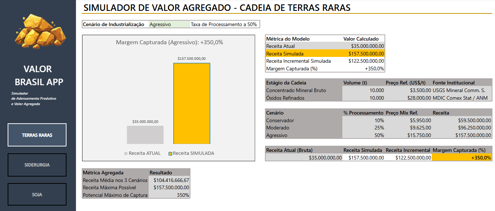
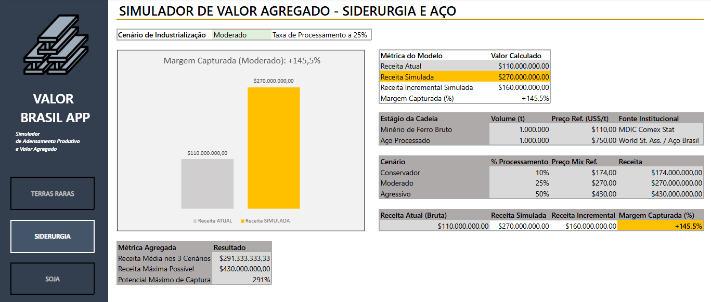
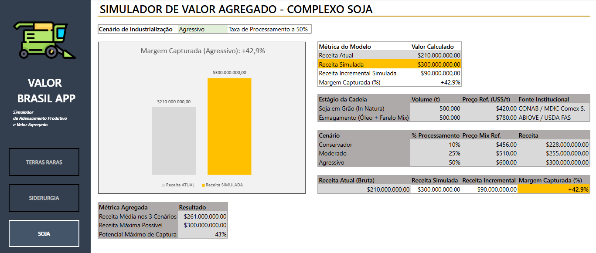

# 🇧🇷 VALOR BRASIL APP — Simulador de Adensamento Produtivo e Valor Agregado

[](https://office.com)
[](#)
[](#)
[](#)

Ferramenta interativa de modelagem analítica e visualização de cenários desenvolvida em **Microsoft Excel**. O projeto demonstra o impacto financeiro e o ganho de receita bruta obtidos ao migrar da exportação de matérias-primas brutas para produtos industrializados de maior valor agregado nas três principais cadeias exportadoras brasileiras: **Terras Raras**, **Siderurgia & Aço** e **Complexo Soja**.

---

## 📌 Visão Geral do Projeto

O Brasil destaca-se mundialmente pela exportação de grandes volumes de commodities primárias. No entanto, ao longo da cadeia de suprimentos, os produtos que passam por etapas adicionais de beneficiamento e refino capturam margens financeiras significativamente superiores por tonelada.

O **Valor Brasil App** responde analiticamente à seguinte questão central:

> **"Qual seria o ganho potencial na receita bruta de exportação do Brasil caso uma parcela da produção nacional fosse processada internamente antes do envio ao exterior?"**

### Raciocínio Teórico e Metodológico
Para garantir rigor conceitual e afastar interpretações equivocadas de "previsão econômica", o modelo fundamenta-se nos princípios de **Trade in Value Added (TiVA)** da **OCDE** e em estudos de diferencial de preços do **MDIC/ZPE**. Adotam-se terminologias como:

- **Receita Atual (Bruta):** Faturamento com base na exportação in natura/bruta.
- **Receita Simulada:** Faturamento estimado a partir do mix de produtos processados.
- **Receita Incremental Simulada:** O valor absoluto adicional capturado ($\text{Receita Simulada} - \text{Receita Atual}$).
- **Margem Capturada (%):** O percentual relativo de crescimento da receita.

---

## 💻 Módulos e Dashboards do Projeto

O arquivo do modelo é estruturado em 3 abas analíticas totalmente independentes, operando através de um motor de cálculo dinâmico e interface executiva limpa.

### 🧲 Aba 1: Terras Raras (`Terras_Raras`)
Simula a transição do concentrado mineral bruto para óxidos refinados/separados de alto valor tecnológico.

- **Preço Ref. Bruto:** US$ 3.500,00 / t (Concentrado Mineral)
- **Preço Ref. Processado:** US$ 28.000,00 / t (Óxidos Refinados)
- **Fontes de Dados:** USGS Mineral Commodity Summaries, MDIC Comex Stat, ANM.



---

### 🏭 Aba 2: Siderurgia e Aço (`Siderurgia_Aco`)
Simula o adensamento produtivo da cadeia mineral, transformando minério de ferro bruto em produtos siderúrgicos e laminados de aço.

- **Preço Ref. Bruto:** US$ 110,00 / t (Minério de Ferro Bruto)
- **Preço Ref. Processado:** US$ 750,00 / t (Aço Processado / Laminados)
- **Fontes de Dados:** World Steel Association, Instituto Aço Brasil, MDIC Comex Stat.



---

### 🌱 Aba 3: Complexo Soja (`Complexo_Soja`)
Simula o impacto do esmagamento da soja em grão in natura para a exportação do mix industrializado de óleo e farelo.

- **Preço Ref. Bruto:** US$ 420,00 / t (Soja em Grão)
- **Preço Ref. Processado:** US$ 780,00 / t (Esmagamento - Mix Óleo e Farelo)
- **Fontes de Dados:** CONAB, USDA FAS, ABIOVE.



---

## 🎮 Interatividade e Regras do Modelo

A navegação e a sensibilidade de cenários são executadas diretamente pelo usuário através de controles dinâmicos dispostos no cabeçalho de cada aba:

### Cenários de Industrialização
Utilizando uma **Validação de Dados em Lista Suspensa**, o usuário seleciona o percentual da produção nacional redirecionado ao processamento:

| Cenário Selecionado | Taxa de Processamento (% Industrializado) | Parcela Comercializada In Natura |
| :--- | :---: | :---: |
| **Conservador** | **10%** | 90% |
| **Moderado** | **25%** | 75% |
| **Agressivo** | **50%** | 50% |

### Destaques e Indicadores (Bloco de KPIs)
1. **Receita Atual (Bruta):** Faturamento base do volume total sem beneficiamento.
2. **Receita Simulada:** Faturamento dinâmico com base na taxa de processamento do cenário.
3. **Receita Incremental Simulada:** Indicador de maior destaque visual no painel ($\text{Receita Simulada} - \text{Receita Atual}$).
4. **Margem Capturada (%):** Crescimento percentual da receita ($\frac{\text{Receita Incremental}}{\text{Receita Atual}}$).

### Visualização Gráfica Dinâmica
- **Tipo de Gráfico:** Colunas Agrupadas comparando diretamente **Receita Atual vs. Receita Simulada**.
- **Texto Dinâmico Vinculado (Header de Gráfico):** Exibe automaticamente acima do gráfico o cenário e a margem obtida (Exemplo: `"Margem Capturada (Agressivo): +350,0%"`).
- **Zero VBA / Zero Macros:** Todo o recálculo do gráfico e dos cards ocorre instantaneamente via motor de fórmulas nativas do Excel.

---

## 🛠️ Arquitetura Técnica e Recursos do Excel

### Fórmulas Matemáticas e Estatísticas
- `SOMA()`: Consolidação dos totais de receita e volume.
- `MÉDIA()`: Cálculo da receita média estimada entre os três cenários simultaneamente.
- `MÁXIMO()`: Identificação da receita teto no cenário de maior adensamento.
- Operações Aritméticas Diretas: Cálculo do Preço Ponderado Mix (`Preço Bruto * (1 - %Proc) + Preço Refinado * %Proc`).

### Fórmulas de Busca Dinâmica
- `PROCV()`: Leitura do cenário escolhido na tabela auxiliar para determinação do Preço Mix.
- `CORRESP()`: Indexação dinâmica de colunas na matriz de simulação.

### Recursos de Layout e Usabilidade
- **Menu Lateral Executivo:** Navegação fluida entre abas via Hyperlinks internos nativos (`#Terras_Raras!A1`, `#Siderurgia_Aco!A1`, `#Complexo_Soja!A1`).
- **Formatação de Números Personalizada:**
  - Volume: `#.##0 "t"`
  - Moeda: `US$ #.##0,00`
  - Percentual com Sinal: `+0,0%;-0,0%`
- **Diretrizes Visuais:** Ocultação de linhas de grade, aplicação de paleta corporativa neutra com destaques em contraste amarelado/dourado para a Receita Simulada.

---

## 🎯 Competências Demonstradas

- **Modelagem de Cenários em Excel:** Criação de matrizes flexíveis e dinâmicas acionadas por entrada do usuário.
- **Análise Econômica de Trade & Commodities:** Domínio conceitual sobre precificação de commodities e agregação de valor em exportações.
- **Data Visualization & Dashboard Design:** Layout clean com hierarquia visual clara (Cards, KPIs e Gráficos combinados).
- **Comunicação de Insights & Storytelling:** Apresentação clara de dados analíticos orientados a tomada de decisão executiva.

---

## ⚠️ Disclaimer e Fontes de Dados

Os dados de volume e preço utilizados constituem parâmetros de referência institucional extraídos de órgãos governamentais e associações setoriais (**USGS, ANM, MDIC Comex Stat, World Steel Association, Instituto Aço Brasil, CONAB, ABIOVE, USDA**). Este projeto possui caráter puramente analítico, educacional e demonstrativo, não devendo ser utilizado como previsão econômica ou recomendação de investimento.

---

## 📂 Estrutura do Repositório

```text
valor-brasil-app/
│
├── README.md                           <- Documentação completa do projeto
├── Valor_Brasil_App.xlsx               <- Modelo financeiro e simulador em Excel
└── screenshots/                        <- Imagens utilizadas no README
    ├── terras-raras-dashboard.png
    ├── siderurgia-dashboard.png
    └── complexo-soja-dashboard.png